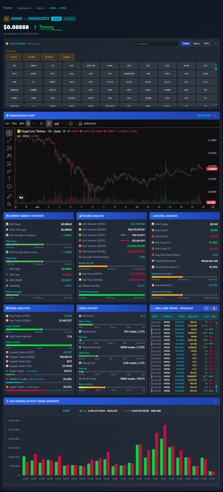

# Gate Live Statistics

Market activity is easier to understand when price context, recent trades and analytics are visible together. Gate Live Statistics brings them into an interactive trading-information workspace, with site administration tools for maintaining the published market catalogue.

## Tech stack

| Layer | Technologies |
|---|---|
| Application | PHP, WordPress |
| Supporting technologies | HTML, CSS, JavaScript; Gate; TradingView; WebSockets |

## Find and revisit a market

Symbol navigation, an active-coin picker and favourites help visitors move between the markets they follow. The selected market's header keeps key information in view. This reduces repeated searching during a session.

Use the market catalogue to begin broadly, then return to a familiar pair when the question is specific. The selected market becomes the anchor for its chart and statistics.

## Read the chart and daily context

The chart sits alongside daily market panels so visitors can connect recent price movement with broader activity. Layout and time-related controls support changing the focus of the investigation. The result is a market workspace rather than a single price widget.

Daily figures and the chart offer different perspectives on the same pair. Keeping them together helps visitors move between the latest observation and the surrounding trading period.

## Follow trading activity

The live tape, trade analytics and daily activity chart offer different perspectives on recent trades. Available activity indicators help visitors explore patterns without assuming that every pattern has one explanation. The panels support observation and comparison.

Recent activity adds detail beyond the headline price. Review the available trade information when a change in the chart calls for a closer look.

## Maintain the published markets

Coin Manager gives the site owner controls for the tracked catalogue, including adding and reloading entries and reviewing inactive markets. Activity history helps understand maintenance work. This keeps market availability a visible publishing task.

The site owner can maintain which markets are offered and review their current state. This keeps catalogue decisions connected to what visitors can actually browse.

## Check health and discoverability

Monitoring panels, logs and server information assist with operational questions, while sitemap and indexing controls support the public pages. Structured-data checks help maintain their presentation to search services.

Publishing checks support the operator when a page seems stale or a market is difficult to find. These maintenance tasks remain distinct from the visitor's market research.

---

Private code: [gate-live-stats-plugin](https://github.com/logicencoder/gate-live-stats-plugin)

See [REPOS.md](REPOS.md) for related repositories.

**[Logic Encoder](https://logicencoder.com)** · [GitHub](https://github.com/logicencoder) · [Contact](https://logicencoder.com/contact/)
